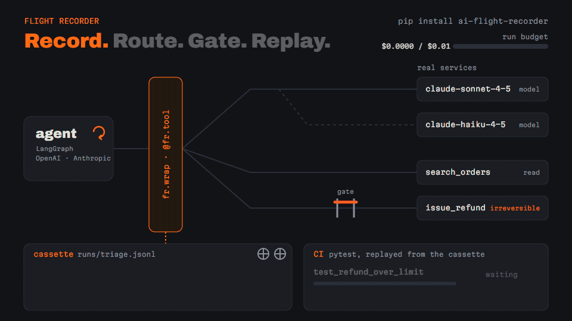
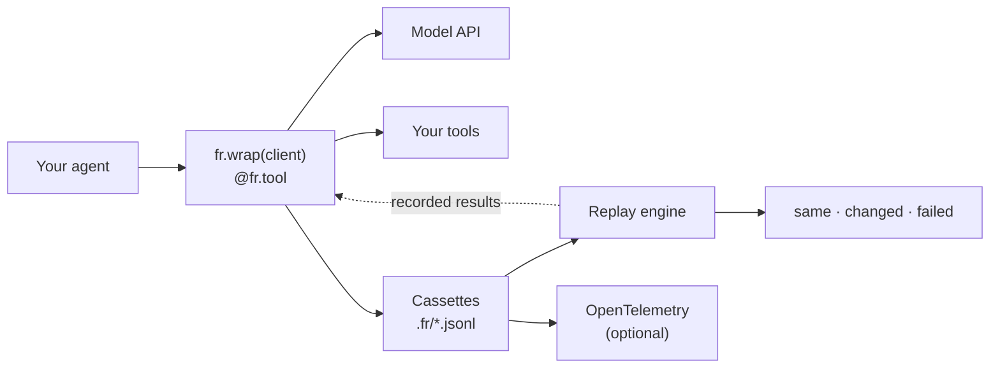

<div align="center">

# Flight Recorder

**Record every step of an AI agent run. Replay it as a regression test in CI.**

Every model call and tool call, with messages, tokens, cost and latency, in plain JSONL files.<br>
Replay a recorded run against a changed agent and get one verdict: same, changed or failed.

[](https://github.com/swap-mitra/ai-flight-recorder/actions/workflows/ci.yml)
[](https://pypi.org/project/ai-flight-recorder/)
[](https://www.python.org/downloads/)
[](LICENSE)

[Quick start](#quick-start) · [Replay tests](#replay-tests-in-ci) · [How it works](#how-it-works) · [Contributing](CONTRIBUTING.md)



</div>

## Contents

- [Why Flight Recorder](#why-flight-recorder)
- [How it works](#how-it-works)
- [Requirements](#requirements)
- [Quick start](#quick-start)
- [Recording model calls](#recording-model-calls)
- [LangChain and LangGraph](#langchain-and-langgraph)
- [Replay tests in CI](#replay-tests-in-ci)
- [Matching and divergence](#matching-and-divergence)
- [Budgets and routing](#budgets-and-routing)
- [Approval gates](#approval-gates)
- [Configuration](#configuration)
- [Command line](#command-line)
- [Failure handling](#failure-handling)
- [Development](#development)
- [Troubleshooting](#troubleshooting)
- [Project status](#project-status)
- [About the name](#about-the-name)
- [Contributing](#contributing)
- [License](#license)

## Why Flight Recorder

An agent is a loop of model calls and tool calls, and a one-word prompt change can send it down a different path: other tools, other arguments, a refund that should not happen. Unit tests rarely see that, because the interesting behaviour lives in the run, not in any one function.

Flight Recorder captures the run. It wraps your model client and your tools, writes every step to a readable JSONL cassette, and lets the same cassette drive a test: replay serves the recorded tool results (and, if you like, the recorded model responses), runs your changed agent against them, and reports what moved. Recording adds under 2 ms per call, fails open so your agent never notices it, and sends nothing anywhere you did not configure.

## How it works



| Component | Location | Responsibility |
| --- | --- | --- |
| Interceptors | `intercept/` | Wrap OpenAI and Anthropic clients, LangChain models and tools, and `@fr.tool` functions. Return exactly what the real call returned. |
| Recorder | `recorder.py`, `context.py` | Group steps into runs (`fr.run`), nest sub-agent runs, total tokens and cost. |
| Store | `store/` | One JSONL cassette per run plus a rebuildable SQLite index. |
| Replay engine | `replay/` | Serve recorded steps instead of live calls, detect divergence, diff a run against its baseline. |
| pytest plugin | `pytest_plugin.py` | `fr_run` fixture, `@pytest.mark.fr`, record and replay modes, reports. |
| Exporter | `export/` | Optional OpenTelemetry export in the GenAI semantic conventions. |

## Requirements

- Python 3.11 or newer
- No API key for the quick start. Recording a real agent uses your own OpenAI or Anthropic key, as your agent already does.

## Quick start

```bash
pip install ai-flight-recorder
```

Save this as `agent.py`:

```python
import flight_recorder as fr


@fr.tool(effect="read")
def lookup_order(order_id: str) -> dict[str, str]:
    return {"order_id": order_id, "status": "shipped"}


@fr.tool(effect="irreversible")
def issue_refund(order_id: str, amount: float) -> str:
    return f"refunded {amount} on {order_id}"


with fr.run("refund-desk", inputs={"order_id": "A-17"}) as run:
    order = lookup_order("A-17")
    run.output = issue_refund(order["order_id"], 19.99)

print(run.run_id)
```

Run it, then look at what was recorded:

```bash
python agent.py          # prints the run id
fr runs                  # list runs, newest first
fr show <run id>         # every step, in order (a unique prefix of the id works)
```

Runs are written to `.fr/` in the current directory. Set `FR_DIR` or `fr.configure(dir=...)` to change it.

## Recording model calls

Wrap the client instance. Calls, streams and async calls behave exactly as before.

```bash
pip install 'ai-flight-recorder[openai]'      # or [anthropic]
```

```python
from openai import OpenAI

client = fr.wrap(OpenAI())

with fr.run("triage"):
    client.chat.completions.create(model="gpt-4.1-mini", messages=[...])
```

`fr.wrap` takes `OpenAI`, `AsyncOpenAI`, `Anthropic` and `AsyncAnthropic`, and records Chat Completions, Responses and Messages, including `parse()`, streams and stream helpers. Cost comes from a shipped pricing table (tokens, cache reads and writes, and per-call fees for web and file search); a model missing from it records a null cost and warns once, never a guess.

## LangChain and LangGraph

```bash
pip install 'ai-flight-recorder[langchain]'
```

```python
model = fr.langchain.wrap_model(ChatOpenAI(model="gpt-4.1-mini"))
tools = fr.langchain.wrap_tools(tools, effects={"search": "read"})
```

Steps inside a LangGraph graph are tagged with their node (`node:agent`). Replay serves wrapped tools too, under the live tool call id, so the model's conversation stays consistent.

## Replay tests in CI

Turn an agent run into a regression test with the pytest plugin, which loads automatically once the package is installed:

```python
import pytest


@pytest.mark.fr(cassette="triage/refund_over_limit")
def test_refund_over_limit(fr_run):
    fr_run.output = triage_agent(TICKET)
```

```bash
pytest --fr-mode=record     # run live once; writes .fr/cassettes/triage/refund_over_limit.jsonl
git add .fr/cassettes       # baselines are reviewed and committed like code
pytest                      # replay (the default): no live tool calls, one verdict per case
```

| Verdict | When |
| --- | --- |
| **failed** | A call with no recorded match (strict divergence), an exception, a step whose status changed, or a different final output |
| **changed** | Tools added, removed or called with other arguments, or a different model, with the same final output |
| **same** | Nothing differs |

`failed` fails the test. `changed` warns, or fails with `--fr-on-change=fail`. Accept a deliberate change with `fr accept triage/refund_over_limit` or `pytest --fr-update`, and the cassette diff shows up in your PR.

Two replay modes:

- **Tools recorded** (default): tool results come from the cassette, models run live. Use it to test prompt and model changes. Models vary, so repeat a case and pass on a threshold: `@pytest.mark.fr(repeats=5, min_pass=4)`.
- **Fully recorded** (`--fr-replay=full`, or `replay="full"` in the marker): model responses come from the cassette too. Deterministic, free, and no network: any change to what the agent sends the model fails the case.

`pytest --fr-report=reports` writes `report.json` and `report.md`, a table ready to post as a pull request comment. This repository's own CI does exactly that: it replays a LangGraph reference agent, and checks that a deliberately broken prompt fails.

## Matching and divergence

Replay walks the recording in order. A tool call matches the next recorded call of the same tool with the same arguments, after redaction, so a redacted secret still matches. Tune it per tool:

```python
fr.matcher("search_orders", ignore=["$.request_id"])  # leave fields out
fr.matcher("search_orders", compare=lambda recorded, live: ...)  # your own rule
fr.matcher("search_orders", on_divergence="live")  # call it for real
```

When nothing matches, the policy decides: `strict` (default) fails the case, `stub` raises `ReplayDivergence` inside the tool so the agent can recover, `live` calls the real tool. Live is refused at startup for irreversible tools, and for write tools unless you pass `allow_write=True`. `@pytest.mark.fr(lookahead=1)` lets replay skip a recorded read the agent no longer makes.

The failure says exactly where the run went off the recording:

```
replay of run 'test_refund' diverged at step 1 (strict):
  expected: {"args":{"amount":5.0,"order_id":"o1"},"tool":"refund"}
  actual:   {"args":{"amount":50.0,"order_id":"o1"},"tool":"refund"}
  after:    {"args":{"order_id":"o1"},"tool":"lookup"}
```

## Budgets and routing

A policy file caps what agents spend and decides which model each call goes to. It is checked when `fr.configure(policy="fr.toml")` loads it, so a mistake fails at startup, never mid-run.

```toml
[budgets]
per_run_usd = 0.50
per_day_usd = 25.00          # shared by every process using this store
soft_warning = 0.8           # log a warning at 80% of a limit
on_breach = "downgrade"      # warn | downgrade | deny (default)
downgrade_to = { anthropic = "claude-haiku-4-5", openai = "gpt-5-mini" }

[budgets.by_run_name.triage]
per_run_tokens = 20000

[[routes]]                   # first match wins
match = { tag = "extract" }
model = "anthropic/claude-haiku-4-5"

[[routes]]
match = { run_name = "report", min_input_tokens = 20000 }
model = "openai/gpt-5.5"

[fallback]                   # on 429s, 5xx and timeouts, after the SDK's own retries
"claude-opus-5" = ["claude-opus-5-5"]
```

```python
with fr.run("triage"):
    with fr.step_tag("extract"):  # also a decorator
        fields = client.messages.create(model="claude-opus-5", ...)  # sent to Haiku
```

- **Before a call is sent**, its cost is projected from its input tokens and its `max_tokens`, and judged against what the run (and today) already spent. Input tokens are estimated from characters; `token_count = "provider"` asks the provider's counting endpoint instead, at one extra request per call. A call over a hard limit raises `BudgetExceeded` and is never sent; the step and the run are recorded as `denied`.
- **A route moves a call within its provider**, so routes and fallbacks to another provider's model never apply. The step records `model_requested` and `model_used`, and each failed fallback attempt.
- **Replays don't touch the daily budget**, and the policy's hash is on every run.

Prove a routing change with replay before it ships. `fr eval-route` replays the test suite under a candidate policy, with tool results from the recordings and the models called live, and reports how often the verdict stays `same` and what it costs:

```bash
fr eval-route --policy cheaper.toml --report reports -- tests/
```

| Run | Same verdict | Baseline cost | Candidate cost | Cost delta |
| --- | --- | --- | --- | --- |
| `test_demo_task` | 100% (1/1) | $0.0400 | $0.0080 | -$0.0320 (-80.0%) |

## Approval gates

The gate stops an irreversible tool call (a refund, an email, a delete) until a rule allows it or a person approves it. It lives in the same policy file; without a `[gate]` section nothing is gated.

```toml
[gate]
approval_timeout = "15m"       # unanswered requests are denied
on_denied = "raise"            # or "return_to_model": the agent reads the denial

[gate.effects]
send_email = "irreversible"    # classify tools here too; the policy wins

[gate.webhook]
url = "https://approvals.example.com/fr"
secret_env = "FR_WEBHOOK_SECRET"   # HMAC secret, read from the environment

[[gate.rules]]
id = "small-refunds"
tool = "issue_refund"
when = "args.amount <= 100"
action = "allow"

[[gate.rules]]
tool = "delete_*"
env = "prod"                   # FR_ENV, default dev
action = "deny"
```

- **Rules run in order; the first match wins.** With no match, read and write tools run and irreversible tools need approval. A tool that doesn't declare its class is irreversible. `when` conditions compare `args`, `run` and `env` fields and are checked when the policy loads, never passed to `eval()`; `when_fn = "module:function"` covers anything more.
- **Approve or deny** from the CLI (`fr approve <id>`, `fr deny <id>`), from Python (`fr.approvals.pending()`, `fr.approvals.resolve(id, "approve")`), on the terminal (`prompt = true`), or through the webhook: each request is POSTed, signed, to your service, which answers through `fr.approvals.asgi_app(secret)` mounted beside it.
- **A request is decided once** and saved before anyone hears of it. Async agents keep running while one call waits.
- **The gate fails closed.** If evaluating it fails or its store is unusable, the call is denied unless the tool only reads.
- **Every decision is on its step**, and `fr audit` exports every irreversible call with its rule, outcome, approver and reason. In replay the recorded decisions stand and the current rules are checked, so tightening a rule shows up as a gate change.

## Configuration

```python
fr.configure(
    dir=".fr",  # or FR_DIR
    redact=[fr.redact.pattern(r"ACCT-\d+"), fr.redact.path("$.tool.args.card")],
    pricing="prices.toml",  # add or override model prices
    policy="fr.toml",  # budgets, routes, fallbacks and the gate
    otel=True,  # export runs to OpenTelemetry
)
```

- **Redaction** runs before anything is written or exported. Common secrets (API keys, bearer tokens) are redacted by default; add regex, JSON path or callable rules.
- **OpenTelemetry** (`pip install 'ai-flight-recorder[otel]'`): each run becomes one trace of GenAI spans in your application's tracer provider. Message content is off unless `OTEL_INSTRUMENTATION_GENAI_CAPTURE_CONTENT` is `SPAN_ONLY`, and then follows the conventions' message schema.

| Variable | Purpose |
| --- | --- |
| `FR_DIR` | Store directory. Default `.fr`. |
| `FR_ENV` | Deployment name gate rules match on (`env`). Default `dev`. |
| `FR_WEBHOOK_SECRET` | The webhook's HMAC secret (the variable `secret_env` names). |
| `OTEL_INSTRUMENTATION_GENAI_CAPTURE_CONTENT` | `SPAN_ONLY` exports message content on spans, after redaction. |

### Store layout

```
.fr/
  cassettes/<case>.jsonl        test baselines: commit these
  replays/<case>.jsonl          the latest replay of each case
  runs/<date>/<run_id>.jsonl    production recordings
  index.sqlite                  rebuildable with fr reindex
  state.sqlite                  daily budget counters, approval requests
```

## Command line

| Command | Purpose |
| --- | --- |
| `fr runs [--name] [--status] [--since 7d] [--limit]` | List runs |
| `fr show <run>` | Print a run step by step |
| `fr diff <baseline> <candidate>` | Diff two runs or cassettes; exit 1 if failed |
| `fr accept <case>` | Make a case's latest replay its baseline |
| `fr eval-route --policy <file> [-- pytest args]` | Replay the suite under a candidate policy; report same-verdict rate and cost delta per run |
| `fr approve <id>`, `fr deny <id>` | Decide a pending tool call (`--approver`, `--reason`) |
| `fr audit [--since 7d] [--format csv\|json]` | Export every irreversible call and its decision |
| `fr reindex` | Rebuild the index from the cassettes |

## Failure handling

- **Interception is invisible.** Your agent gets exactly what the real call returned or raised, and streamed chunks arrive as they arrive.
- **Recording fails open.** A full disk or an unreachable exporter logs one warning per run; the agent carries on. A test that records a baseline is the exception: it fails if its baseline was not written.
- **Cost is never guessed.** An unpriced model or modifier records `cost: null`, and a USD budget does not judge a call it cannot price.
- **The gate fails closed.** An error in it, or an unusable approval store, denies the call unless the tool only reads. An irreversible action never runs because the approval path was down.
- **Budgets and routing fail open.** An error inside them sends the original request unchanged and logs one warning per run. Only a budget's own denial stops a call.
- **No telemetry.** Nothing leaves your machine except your own model and tool calls and the exporter you configure.

## Development

```bash
git clone https://github.com/swap-mitra/ai-flight-recorder.git
cd ai-flight-recorder
uv sync
uv run ruff format . && uv run ruff check .
uv run pyright          # strict
uv run pytest
```

SDK contract tests run the real OpenAI and Anthropic SDKs against mock HTTP transports, so the suite needs no keys or network. CI also runs an overhead benchmark (under 2 ms median per call), the README quick start from a clean install, and a dogfood suite: a LangGraph agent over [Heptapod](https://github.com/swap-mitra/heptapod)'s tools, recorded, replayed, and checked to fail on a broken prompt.

## Troubleshooting

| Symptom | Cause and fix |
| --- | --- |
| `no cassette at .fr/cassettes/...; record it with pytest --fr-mode=record` | The case has no baseline yet. Record it once and commit it. |
| `replay ... diverged at step N (strict)` | The agent made a call the recording has no match for. If the change is intended, record again or accept the replay; if a field always differs, `fr.matcher(..., ignore=[...])`. |
| A tools-recorded case fails some runs | Live models vary. Repeat it with `repeats` and `min_pass`, or replay fully recorded. |
| `cost` is null | The model is not in the pricing table. Add it with `fr.configure(pricing="prices.toml")`. |
| `BudgetExceeded: per-run USD budget ...` | A call would break a hard budget, so it was not sent and the run is recorded as `denied`. Raise the limit, or set `on_breach` to `warn` or `downgrade`. |
| `ToolDenied: ... was not approved in time` | Nobody decided before `approval_timeout`. Check that a channel is set up (webhook, prompt, or `fr approve`), or allow the call with a rule. |
| `PolicyError ... is not allowed` in a `when` | Conditions accept comparisons, `and`/`or`/`not`, literals and `args`/`run`/`env` fields only. Use `when_fn` for more. |
| `PolicyError ... say which provider` | A policy names a model the pricing table doesn't know. Write it as `openai/<model>` or `anthropic/<model>`. |
| `PolicyError ... live on divergence` | Live replay of a write or irreversible tool is refused. Use `stub`, or `allow_write=True` for a write tool you trust. |

## Project status

Version 0.4 adds approval gates for irreversible tool calls, with CLI, Python, terminal and webhook approvals and `fr audit`, which completes the planned releases. Version 0.3 added budgets, model routing, fallbacks and `fr eval-route`. Version 0.2 added replay: record and replay modes in pytest, divergence policies, diffs and verdicts, repeats, reports and baseline updates. Version 0.1 shipped recording for OpenAI, Anthropic, LangChain and plain Python tools, OpenTelemetry export and pricing.

## About the name

An aircraft's flight recorder captures everything that happens on a flight, so that when something goes wrong you can replay exactly what happened instead of guessing. Agents need the same thing: a record of every decision and every action, and a way to play it back.

## Contributing

Contributions are welcome. See [CONTRIBUTING.md](CONTRIBUTING.md) for setup and conventions, and [SECURITY.md](SECURITY.md) to report a vulnerability privately.

## License

Released under the [Apache License 2.0](LICENSE).
